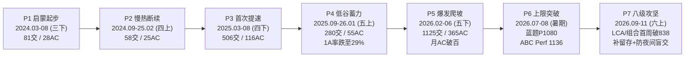

# 麒麒（陈彦旭）信息学奥赛成长路径全记录（2024.03 – 2026.11）

> **档案定位**：本文件基于四大刷题平台全量 **2,705 条精确带时间戳的真实提交记录**（信奥李拜天 898 + 洛谷 867 + 好吧平台 657 + AtCoder 283；`AC` 894 / `WA` 820 / `Unaccepted(洛谷)` 533 / `TLE` 191 / `RE` 155 / `CE` 96 / `MLE` 12 / `UKE` 4；AC 768 题次 / 跨站去重 734 独立题 / 真正未 AC 88 题），完整还原麒麒从 **9 岁（三年级下）到 11 岁（六年级上）** 横跨 **30 个月** 的真实学习轨迹。
>
> 它不仅是一份成长纪念与复盘档案，也是 **AI 教练的重要长期记忆**：记录他如何从低年级的缓慢摸索、五上的低谷震荡走到 2026 年的全面爆发，以及当前高阶爬坡期最需要补强的地基、留存与作息习惯。

---

## 一、30 个月成长全景图

## 二、七阶段量化对比总表

| 阶段 | 时间段（学龄） | 总提交 | AC 题数 | 一次过(1A) | 综合 1A 率* | 主训平台与难度台阶 | 阶段关键词 |
| :--- | :--- | ---: | ---: | ---: | ---: | :--- | :--- |
| **P1** | 2024.03 – 2024.08（三下~暑） | 81 | 28 | 18 | 64% | 洛谷红题 + 好吧启蒙 + AtCoder 初体验 | **9 岁起步，慢速萌芽** |
| **P2** | 2024.09 – 2025.02（四上） | 58 | 25 | 13 | 52% | 洛谷红/橙 + 好吧基础 | **低年级慢热与断续期** |
| **P3** | 2025.03 – 2025.08（四下~暑） | 506 | 116 | 58 | 50% | 洛谷橙题(39) + 好吧五一模拟 + AtCoder ABC | **首次提速，初尝竞赛** |
| **P4** | 2025.09 – 2026.01（五上） | 280 | 55 | 16 | **29%** | 洛谷橙/黄过渡 + ABC 震荡 | **过渡阵痛与低谷蓄力** |
| **P5** | 2026.02 – 2026.06（五下） | **1,125** | **365** | 179 | 49% | **李拜天一对一启动** + 洛谷黄题(31)/首绿 + 好吧 | **2026 质变大爆发** |
| **P6** | 2026.07 – 2026.08（五升六暑） | 303 | 85 | 37 | 43% | 洛谷 3 绿 1 蓝 + 李拜天七级/树形DP + ABC470 | **上限拉满，高光频现** |
| **P7** | 2026.09 – 2026.11（六上·当前） | 352 | 94 | 32 | **34%** | 李拜天八级(LCA/组合) + 好吧 PJ 模拟 + ABC | **冲击高阶，暴露留存与疲劳盲交** |
| **合计** | **30 个月全周期** | **2,705** | **768 题次**（去重 734 题） | **353** | **46%** | 四平台全覆盖 | **从慢热到厚积薄发** |

> [!WARNING]
> **\*统计口径警示：综合 1A 率的“辛普森悖论（Simpson's Paradox）”**  
> 绝不可跨月简单拿未按难度分层的“综合 1A 率”下退步结论！以 P7 阶段为例：表面上看 2026 年 10 月总 1A 率高达 **57%（13/23）**，11 月回落至 **27%（11/41）**；但拆开 [solved_timeline.md](solved_timeline.md) 就会发现——**10 月的 13 道 1A 中，有 11 道是好吧 PJ 模拟赛前两道签到基础题**（如 `回文数`、`三连击`、`打印排队`、`密码强度`），而 **10 月同期在信奥李拜天做的 6 道正经算法题（LCA/生成树）1A 率仅 16.7%（1/6）**！到了 11 月，他单月在李拜天攻克了 **14 道 GESP 八级 / NOIP 提高题**，题目难度台阶骤升两个量级。因此后续评估必须**难度分层**（只对基础签到题看 1A ≥ 85%），高阶题改看**失控连交率（单题 ≥4 交占比）**与 **48 小时补题闭环率**。

---

## 三、各阶段详细轨迹与关键里程碑

### P1：启蒙起步期（2024.03 – 2024.08 · 三年级下至暑假，9 岁）
- **节奏特征**：接触早、步子小。半年合计 81 次提交、通过 28 题，以 C++ 基础语法和洛谷入门红题（12 题）为主。
- **关键节点**：
  - `2024-03-25`：在 AtCoder 完成人生第一条公开提交；
  - `2024-04-21`：注册洛谷 `qiq2015`，当晚 AC `P8813 [CSP-J 2022] 乘方`；
  - `2024-05-12` / `2024-07-02`：初次接触经典黄题 `P1007 独木桥`、`P2580`。

### P2：低年级慢热与断续期（2024.09 – 2025.02 · 四年级上）
- **节奏特征**：受限于低年级学龄、校内精力与抽象理解速度，这半年进度非常缓慢——6 个月合计仅 58 次提交、AC 25 题，AtCoder 阶段性停更，只在洛谷和好吧零星保持手感（入门 9 题、普及− 5 题）。
- **意义**：虽然慢，但没有彻底中断，把 C++ 基本语法和循环数组保住了。

### P3：首次提速与竞赛初体验（2025.03 – 2025.08 · 四年级下至暑假，10 岁）
- **节奏特征**：训练量突然跃升近 **9 倍**（506 次提交、116 道 AC 题），首次建立起持续刷题感。
- **关键突破**：
  - 洛谷集中打通 **39 道普及−（橙题）**，开始接触经典贪心黄题（`2025-06-27` 连过 `P1230 智力大冲浪`、`P1650`）；
  - `2025-05` 参加好吧「五一“信息与未来”模拟赛 1~3」；
  - AtCoder 稳定切入 ABC C 题并过掉 `abc130_d`（865 分双指针题）、`abl_c`、`abc269_d`。

### P4：低谷震荡与蓄力期（2025.09 – 2026.01 · 五年级上）
- **节奏特征**：一段明显的**平台震荡与低谷期**。提交量回落至 280 次、AC 55 题；综合 1A 率从 50% 骤降到 29%，2025-11 在 AtCoder `abc430` / `abc431` 连续遭遇低分打击，2026-01 单月提交通过比一度跌至 17%。
- **回头看原因**：孩子正在试图跨出“纯模拟/简单枚举”的舒适区，进入搜索、背包、递归等真正需要算法思维的题目（如 `P2725`、`P10722`、`P10483 小猫爬山`），旧习惯撑不住新难度，产生剧烈摩擦。

### P5：2026 质变爆发期（2026.02 – 2026.06 · 五年级下，11 岁）
- **节奏特征**：**整个 30 个月最大的向上拐点！** 半年狂揽 **1,125 次提交、365 道 AC 题**（占全历史近一半！），4 月（104 AC）、5 月（107 AC）连续两月单月过题破百，且 1A 率强劲回升到 49%。
- **决定性事件**：
  - `2026-02-01` ~ `02-05`：开启 AtCoder EDPC 刷题（`dp_a`~`dp_d`），并啃下 1073 分的 `abc253_e`；
  - `2026-02-11`：一晚连破两道洛谷绿题——**`P1776 宝物筛选`**（多重背包）与 **`P1156 垃圾陷阱`**（背包 DP），正式踏进普及+/提高门槛；
  - `2026-03` 起：接入**信奥李拜天 OJ 每周三一对一专属作业**，半年内系统拿下线性 DP（25+）、贪心（23+）、模拟、DFS/BFS、GESP 六~七级；同时在洛谷集中过掉 **31 道黄题**，并在 `2026-04-06` 一次性 1A 1346 分的 `abc119_d`！

### P6：五升六暑期上限突破期（2026.07 – 2026.08）
- **节奏特征**：厚积薄发，集中验证了孩子的真实天赋上限！
- **高光里程碑**：
  - `2026-07-02`：拿下并查集与最小生成树模板（`P3367`、`P3366`）；
  - `2026-07-06`：1A `P1012 拼数`，当晚死磕 7 次拿下人生第一道洛谷**提高级蓝题 `P1080 [NOIP 2012 提高组] 国王游戏`**！
  - `2026-07-09`：1A AtCoder EDPC `dp_x`（邻项交换+DP）；
  - `2026-07-11` ~ `07-12`：连过绿题 **`P11232 [CSP-S 2024] 超速检测`** 与 **`P8297`**（14 次提交死磕到底）；
  - `2026-08-08`：在 AtCoder **`abc470`** 赛时连过 A/B/C(1006)/D(777)，打出 **1136 Performance（绿名表现）**；8 月下旬在李拜天切入区间 DP 与树形 DP（`最大子树和`、`没有上司的舞会`）。

### P7：六年级上高阶攻坚期（2026.09 – 2026.11 · 当前阶段）
- **节奏特征**：训练强度保持高水平（352 次提交、94 道 AC 题；近 30 天 203 次提交），三条线并行推进——信奥李拜天周三作业已全面切入 **GESP 八级 / NOIP 提高**、好吧平台主攻 **26秋PJ模拟赛**（第十次已拿 5/6 AC）、AtCoder 连续三周参赛并于 11-21 将 Rating 推至 **293（历史新高）**。
- **近期关键脚步**：
  - `2026-09-06`：过 `P4779` 最短路模板；
  - `2026-10-28` ~ `11-10`：密集打通**最小生成树 + 倍增 LCA + 树上差分**（`1524`、`1168`、`1171`、`1525`、`789`、`799`、`806`、`1173`、`787`）；
  - `2026-11-07`：在好吧模拟赛主动提出“要学通知识点”，`11:04` AC `5252 最大子矩阵和` 后，**3 分钟后（`11:07`）就去洛谷独立 AC 了同类迁移题 `P1719`**！
  - `2026-11-11` ~ `11-21`：一对一老师**首次排组合数学课**，首周即 1A `3111 杨辉三角`、2 交过 `788`、4 交过 `794`、7 交啃下 NOIP 提高组 **`838 计算系数`**，同期打通并查集实战（`3241`、`1366 ABC126E`），并主动回头补掉了 8~9 月旧账（`791`、`1142`、`4959`、`abc483_c`、`abc484_c`）。

---

## 四、当前最需要增强的 4 个核心环节（面向下一阶段）

站在 30 个月全周期回望，2026 年的进步是**飞跃式的**。剥离综合 1A 率的辛普森悖论后，真正决定他能否站稳 GESP 八级 / 绿题台阶的，是以下 4 个精准环节：

1. **【补齐前置数学微概念 + 巩固隔月留存（Retention）】**
   - 事实证明麒麒**数学领悟力相当强**（未学高中排列组合却在首周啃下 NOIP 提高组 `838 计算系数`）；李拜天知识图谱里“DP 81 vs. 数学 23（组合 5）”主因是排课顺序先算法后组合。真正的短板在于：**① 校内六年级缺少代数式展开、同余取模、组合恒等式前置微铺垫**；**② 脱离老师刚讲完的热乎劲后，独立建模与隔月旧题留存双双不稳**（如 `4998 LIS` 累计 6 次 0 分、`5236 树的直径` 62 分、`2659 垃圾陷阱` 9 分 TLE）。
   - **增强方向**：日常用「建模练习 → 专题建模快练（破冰基石 + 号家军 10 法）」、课后讲义「🧑‍🏫 慢放拆解数学推导」与手算微卡片 + 每周 20 分钟“隔月旧题冷启动重斩” + 遇非模板题用《麒麒的 OI 数学实验本》走**「实战探索 + 数学搭桥 5 步法」**（手玩小数据破冰 → 数字译字母 → 自诊重复与部分分分流 → 代边界数慢放与直观证明 → 验毒与 `N ≤ 5` 本地暴力对拍）。
2. **【最快提分杠杆】严控失控连交（连错急刹车）**
   - 四平台全量 2,705 次提交中 `WA` 820、`Unaccepted` 533、`TLE` 191、`RE` 155、`CE` 96；近 30 天（203 交）`WA` 85、`TLE` 27、`CE` 9，11 月单题 ≥4 交占比约 **32%**。
   - **增强方向**：帮孩子做平台减法（砍掉好吧重复题海），固化“写前看 `N` 估复杂度 → 本地编译零 CE → 连 2 次 WA 必须回归数学模型或用 `N ≤ 4` 最小反例/本地对拍再交”。
3. **【实战抗压与稳定性】缩小上限与下限的落差**
   - 上限已证明能打 1136 Perf、过蓝题 `P1080` 和八级题，但赛场与模拟赛仍易因急躁或隔月手生掉分（如 `abc484`/`abc485`、`5236`）。目标改为分层指标：**基础签到题 1A ≥ 85% + 全月 CE ≤ 1**，高阶题看 **48 小时补题闭环率**。
4. **【善用已有优势】保护好他的韧性与主动补题习惯**
   - 麒麒从三年级慢热坚持到现在，从来不是“三分钟热度”——他能 14 次死磕 `P8297`、9 次修通 `5275`、主动回头补完 8 月旧题，甚至主动要求“教会知识点而不是只教题”。**这份韧性是他最宝贵的底牌**，辅导时多用他真实走过的里程碑正向激励，用低打字摩擦和 3 秒复盘保护兴趣。

---

## 五、给 AI 教练的长期记忆调用提示

- **孩子自我怀疑/卡题气馁时**：温和提醒他——你六年级就已经能过 `P1080 国王游戏`、`CSP-S 2024 超速检测`、首周啃下 NOIP 提高组 `838 计算系数`、打出 AtCoder `1136` 表现，连 `P1719` 都能 3 分钟迁移 AC，**不是不会，咱们先在演草本上画个 `N = 3` 的具体小例子手算一遍，再一步步把数字翻译成数学式！**
- **交互与建模纪律**：坚持**高含金量低打字摩擦**（用含真实误区干扰项的 A/B/C 选择或演草纸算完报具体数字/简短式子，严禁出“一眼假”送分题）、**实战探索 + 数学搭桥 5 步法**（先从具体小数字破冰，绝不一上来甩满屏抽象字母式或提前剧透算法方向）与**不设任何时间劝睡限制**（无论几点做题均专心辅导）。
- **制定复习与排查范围时**：结合 [solved_timeline.md](solved_timeline.md)、[activity_timeline.md](activity_timeline.md) 和 [skill_matrix.md](skill_matrix.md)，优先复盘近 30 天高摩擦/未过题，并每周挑 1 道 1~2 个月前 ≥4 交才过的旧题做 20 分钟冷启动重斩。
